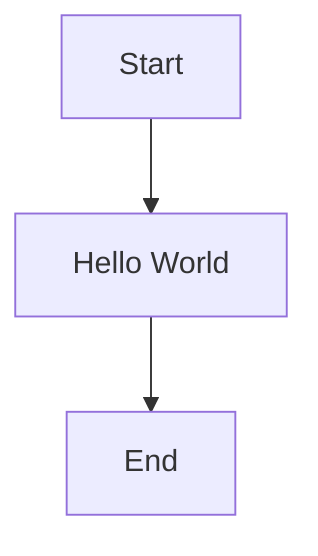

# Himmil's Project

## Maybe using HTML, or JS, web technologies, TBD

 
 
 
 
 

- HTML
- JS
- Python
- TypeScript
- Java
- Web Server

---
### Mermaid

---
### LaTeX

$$
\int_a^b x^2 \, dx = \left[\frac{x^3}{3}\right]_a^b
$$

